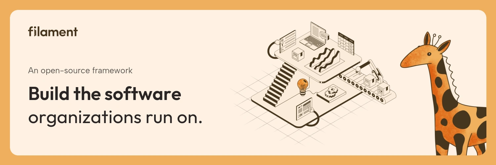

    

    
    
    
    

    

**Filament is an open-source framework for building polished, maintainable business software with Laravel.**

From a single admin panel to customer portals, CRMs, and operational systems, Filament gives you components and conventions that work together. Build features that fit your organization, with a consistent experience for your users and less custom code for your team to maintain.

Business software isn't just for businesses. Filament helps developers build the systems that companies, charities, schools, and public institutions rely on every day.

- **Tables** — Browse, search, and filter records, with customizable columns and individual or bulk actions.
- **Forms** — Build reactive forms with reusable components, validation, and flexible layouts.
- **Infolists** — Present read-only record details with structured layouts and custom formatting.
- **Notifications** — Keep users informed with in-app feedback and persistent notifications.
- **Dashboard widgets** — Bring key metrics, charts, and records together in one place.
- **Actions** — Connect user interactions to application logic, with support for confirmations, forms, and feedback.

[Get Started](https://filamentphp.com/docs) • [Launch Demo](https://demo.filamentphp.com) • [Join Discord](https://filamentphp.com/discord)

---

## Contributing

Please see our [contributing guide](https://filamentphp.com/docs/6.x/introduction/contributing).

## Need Help?

🐞 If you spot a bug, please [submit a detailed issue](https://github.com/filamentphp/filament/issues/new?template=bug_report.yml), and wait for assistance.

🤔 If you have a question or feature request, please [start a new discussion](https://github.com/filamentphp/filament/discussions/new/choose). We also have a [Discord community](https://filamentphp.com/discord). For quick help, ask questions in the appropriate channel.

🔐 If you discover a vulnerability, please review our [security policy](https://github.com/filamentphp/filament/blob/6.x/SECURITY.md).
